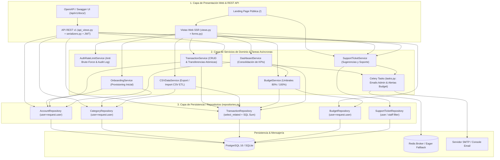
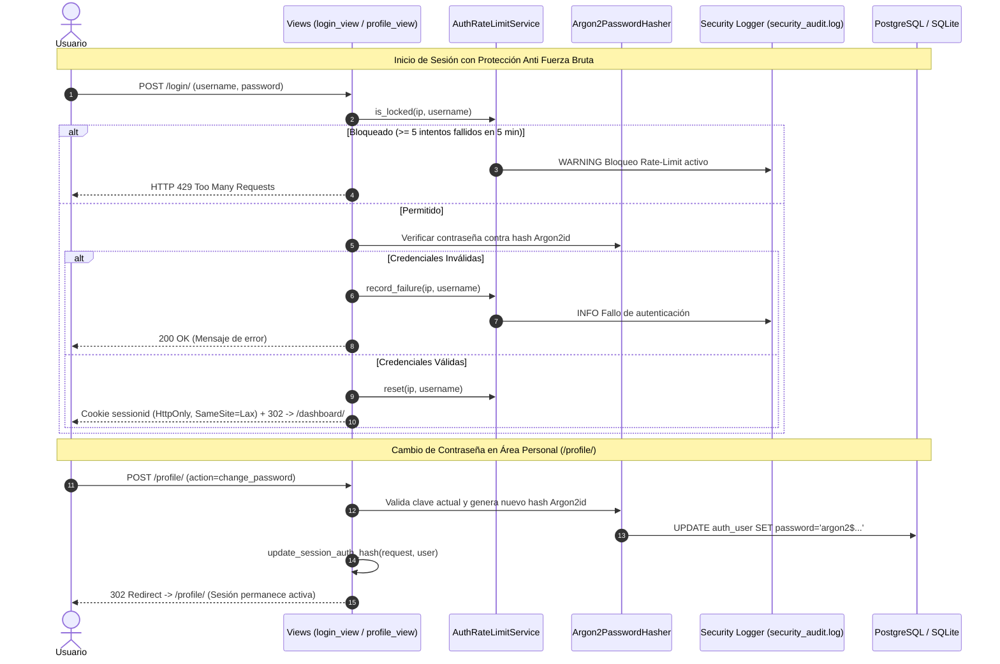
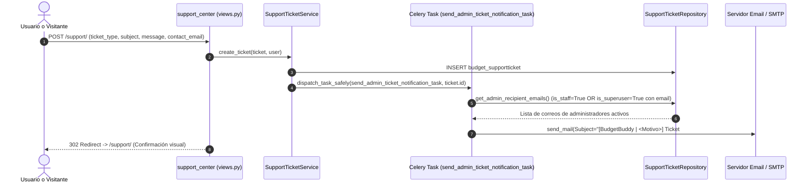
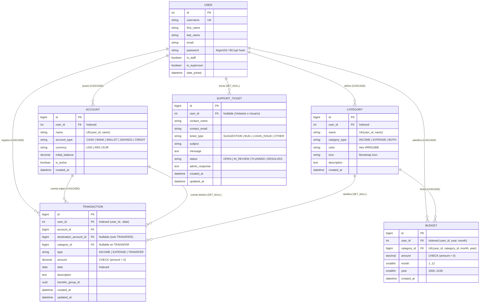

# 🏗️ Arquitectura de Software, Casos de Uso y Modelo de Datos — BudgetBuddy v1.1

Este documento constituye la referencia técnica oficial de **BudgetBuddy**. Describe su arquitectura en capas limpias, los diagramas de casos de uso completos, los flujos de autenticación y notificaciones asíncronas, el modelo entidad-relación (ERD) y la estrategia de aislamiento multi-usuario (*Data Segregation*).

---

## 1. Arquitectura de Software en Capas Limpias (Layered Architecture)

El sistema implementa una separación estricta en **3 capas** dentro de la aplicación `budget/`, complementada con procesamiento asíncrono (**Celery + Redis**) y una **API RESTful (DRF + JWT + OpenAPI)**:

1. **Capa de Presentación y API (`views.py`, `api_views.py`, `forms.py`, `serializers.py`, `urls.py`, `api_urls.py`)**:
   - Gestiona peticiones HTTP SSR (Django Templates + Bootstrap 5 Mobile-Responsive) y endpoints REST (`/api/v1/`).
   - Aplica control de acceso (`@login_required`, `IsAuthenticated`), tokens JWT (`SimpleJWT`) y validación de entrada.
2. **Capa de Servicios / Lógica de Negocio (`services.py` y `tasks.py`)**:
   - Contiene la lógica de dominio desacoplada:
     - `OnboardingService`: Aprovisionamiento atómico de cuenta principal y 7 categorías iniciales al registrarse.
     - `TransactionService`: Validación de pertenencia multi-tenant (`validate_ownership`), registro de ingresos/egresos y transferencias atómicas entre cuentas (`@transaction.atomic`).
     - `BudgetService`: Cálculo de ejecución mensual y umbrales de alerta (`Saludable < 80%`, `En alerta 80-99%`, `Excedido >= 100%`).
     - `CSVDataService`: Exportación compatible con Excel (UTF-8 BOM) e importación masiva de transacciones desde CSV.
     - `SupportTicketService`: Creación de sugerencias/tickets y despacho de alertas por correo a administradores.
     - `AuthRateLimitService`: Bloqueo temporal contra fuerza bruta en login (máx. 5 intentos fallidos / 5 min) y bitácora en `budget.security`.
     - `tasks.py` (Celery): Envío asíncrono de correos de soporte y alertas de presupuesto con fallback síncrono automático (`dispatch_task_safely`).
3. **Capa de Persistencia / Repositorio (`repositories.py`)**:
   - Centraliza todas las consultas ORM (`AccountRepository`, `CategoryRepository`, `TransactionRepository`, `BudgetRepository`, `SupportTicketRepository`).
   - Exige `user: User` en cada método de datos privados y optimiza lecturas con `select_related` y agregaciones SQL (`Sum`, `Coalesce`, `TruncMonth`).

---

## 2. Diagrama de Casos de Uso Completo (UML en Mermaid)

```mermaid
flowchart LR
    Anon["👤 Visitante No Autenticado"]
    AuthUser["🔐 Usuario Autenticado"]
    Admin["🛡️ Administrador (Staff / Superuser)"]

    subgraph PublicScope["1. Espacio Público y Conversión"]
        UC_Landing["Explorar Landing Page Mobile-Responsive (/)"]
        UC_Register["Registrarse con Onboarding Automático (/register/)"]
        UC_Login["Iniciar Sesión con Protección Brute-Force (/login/)"]
        UC_Reset["Recuperar Contraseña por Email (/password-reset/)"]
        UC_PubSupport["Enviar Reporte de Acceso o Sugerencia sin Login (/support/)"]
    end

    subgraph PrivateScope["2. Espacio Financiero y Personal Aislado (Multi-Tenant)"]
        UC_Dash["Visualizar Dashboard, Patrimonio y Balance Histórico (/dashboard/)"]
        UC_Profile["Gestionar Área Personal: Email, Nombre y Cambio de Contraseña (/profile/)"]
        UC_Accounts["Administrar Cuentas Financieras Multi-Moneda (/accounts/)"]
        UC_Tx["Registrar, Filtrar, Editar y Eliminar Ingresos/Egresos (/transactions/)"]
        UC_Transfer["Ejecutar Transferencias Atómicas entre Cuentas (/transfer/)"]
        UC_CSV["Exportar Movimientos a Excel CSV e Importar Lotes CSV"]
        UC_Cat["Personalizar Categorías con Color y Tipo (/categories/)"]
        UC_Budget["Configurar Presupuestos Mensuales y Recibir Alertas Email 80%/100% (/budgets/)"]
        UC_UserSupport["Enviar Sugerencias/Tickets y Consultar Respuestas del Admin (/support/)"]
        UC_API["Consumir API REST con JWT y Explorar Swagger (/api/v1/docs/)"]
        UC_Logout["Cerrar Sesión de Forma Segura (/logout/)"]
    end

    subgraph AdminScope["3. Gestión y Moderación del Sitio"]
        UC_AdminInbox["Revisar Ideas/Sugerencias, Filtrar Tickets y Responder (/support/manage/)"]
        UC_EmailAlert["Recibir Alertas Email Automáticas con Etiqueta de Motivo en Subject"]
        UC_DjangoAdmin["Auditar Entidades en Panel de Supervisión (/supervision-panel/)"]
    end

    Anon --> UC_Landing
    Anon --> UC_Register
    Anon --> UC_Login
    Anon --> UC_Reset
    Anon --> UC_PubSupport

    AuthUser --> UC_Dash
    AuthUser --> UC_Profile
    AuthUser --> UC_Accounts
    AuthUser --> UC_Tx
    AuthUser --> UC_Transfer
    AuthUser --> UC_CSV
    AuthUser --> UC_Cat
    AuthUser --> UC_Budget
    AuthUser --> UC_UserSupport
    AuthUser --> UC_API
    AuthUser --> UC_Logout

    Admin --> UC_AdminInbox
    Admin --> UC_EmailAlert
    Admin --> UC_DjangoAdmin
```

---

## 3. Flujos de Secuencia Principales

### 3.1 Autenticación, Hashing Argon2id, Rate Limiting y Cambio de Contraseña

### 3.2 Creación de Ticket/Sugerencia y Alerta Automática por Email a Administradores

---

## 4. Modelo Entidad-Relación Normalizado (ERD)

---

## 5. Estrategia de Aislamiento Multi-Usuario (Data Segregation en 4 Capas)

1. **Capa de Controladores (`views.py` / `api_views.py`)**: Todas las rutas financieras y de perfil exigen `@login_required` o `IsAuthenticated` (JWT/Session). El panel `/support/manage/` exige además `is_staff` o `is_superuser` (`403 PermissionDenied`).
2. **Capa de Formularios y Serializers (`forms.py` / `serializers.py`)**: Los campos relacionales (`account`, `destination_account`, `category`) filtran su `queryset` exclusivamente con `.filter(user=request.user)`.
3. **Capa de Servicios y Modelos (`services.py` / `models.py`)**: `TransactionService.validate_ownership()` y `Model.clean()` verifican que `category.user_id == user.id` y `account.user_id == user.id`. Cualquier intento de inyección cruzada registra una alerta en `logs/security_audit.log` y lanza `PermissionDenied`.
4. **Capa de Repositorios (`repositories.py`)**: `get_for_user(user, pk)` aplica `get_object_or_404(..., pk=pk, user=user)`, respondiendo `404 Not Found` ante cualquier intento de ataque **IDOR**.
